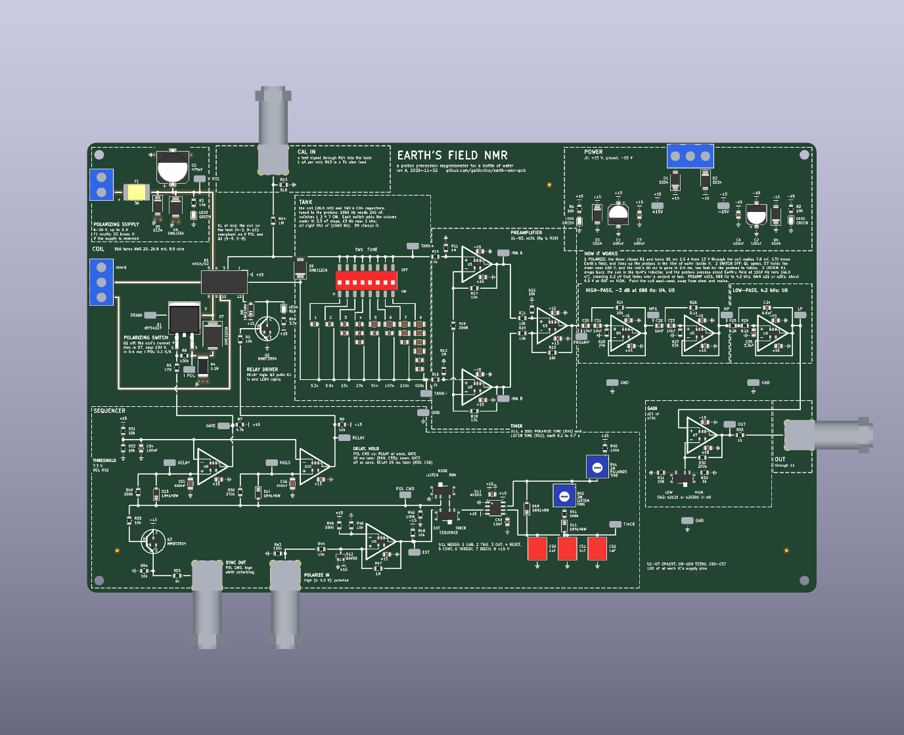
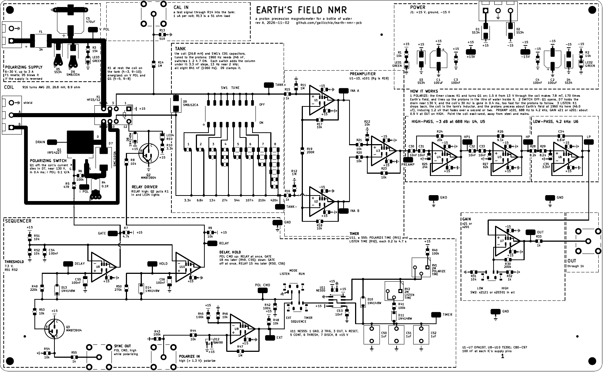
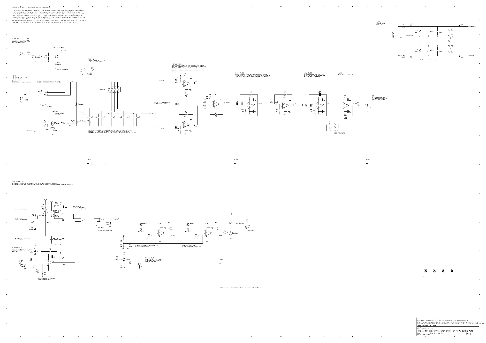
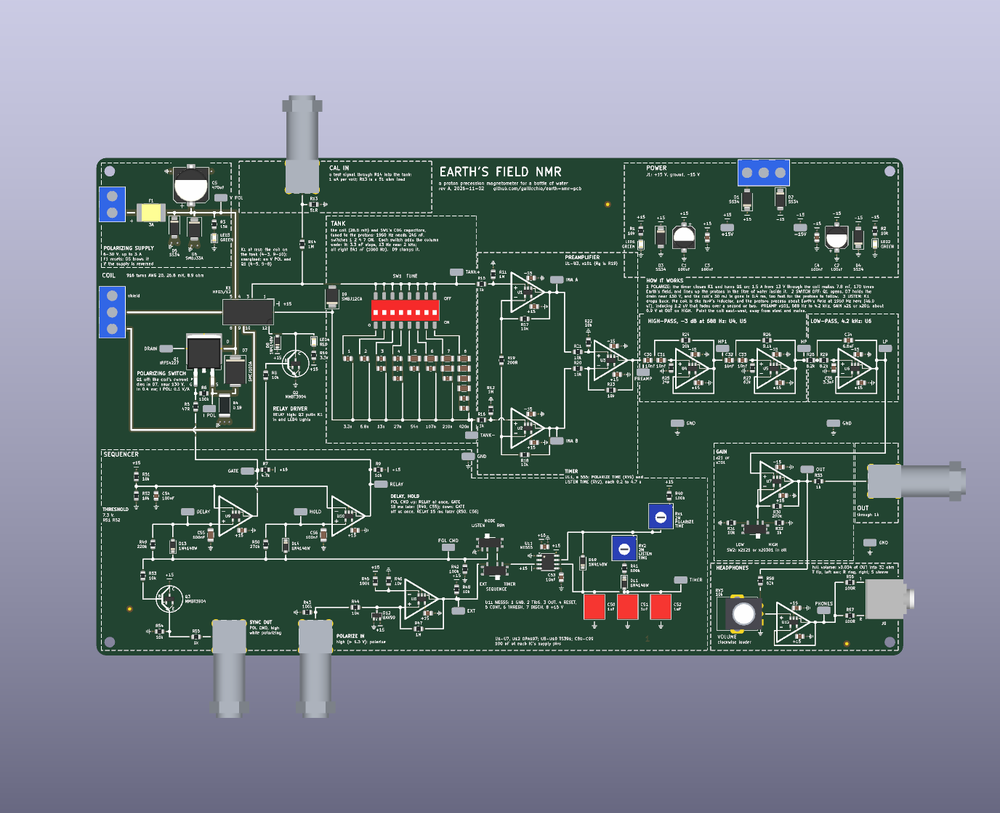
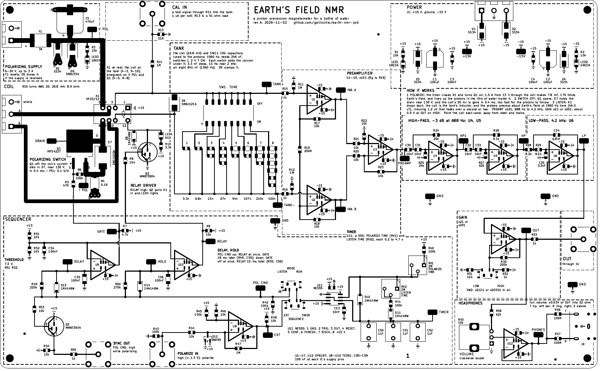
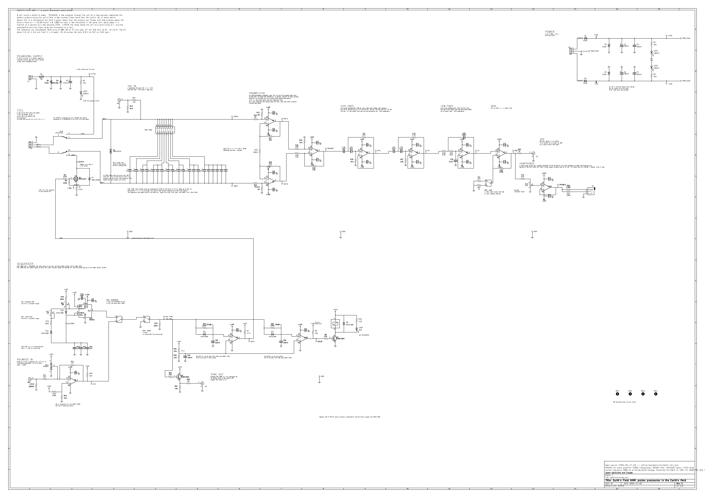
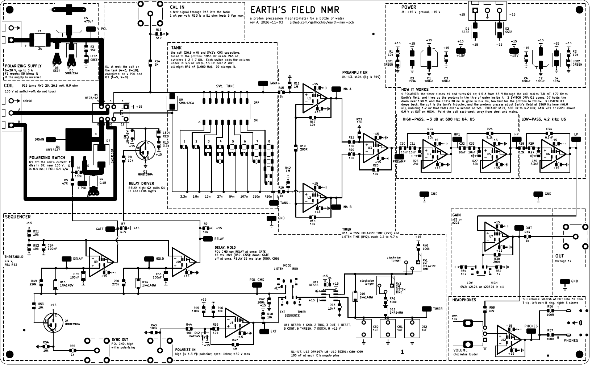
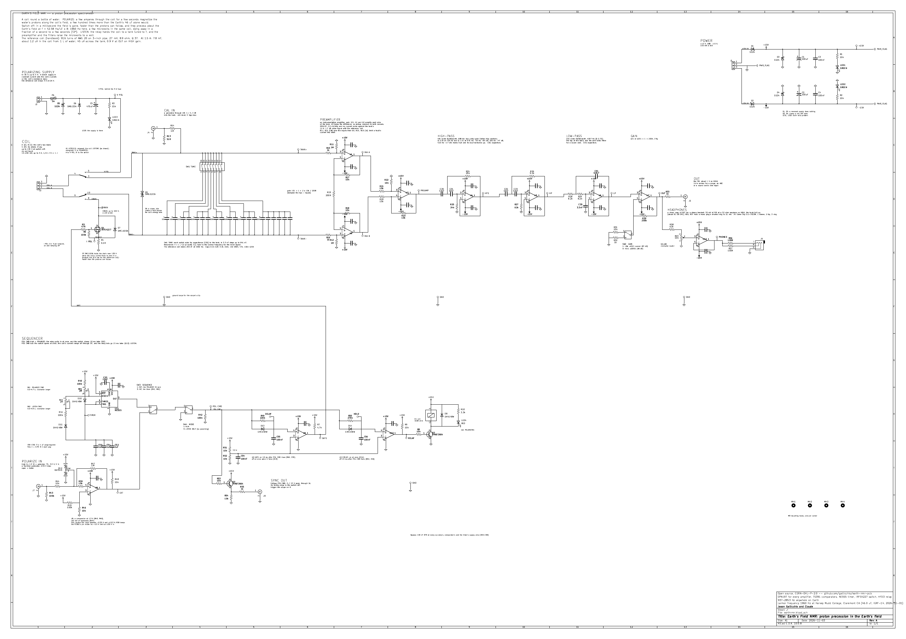

# Claude Code Chat Log — Earth's Field NMR

Every prompt, verbatim, followed by the response as it was given, with the renders as
they were at the time (kept under `docs/history/`).  Claude, in a Claude Code cloud
session.

## Prompt 1

> Design an Earth NMR circuit and PCB like my other PCBs on github. Write only to earth-nmr-pcb, but look at the other repos, especially in OpticsPCBs, where there is a CLAUDE_PCB.md that you should follow. Install kicad 10 in your cloud environment.

## Response 1

*2026-11-01 17:04 PST (01:04 UTC 2026-11-02) to 2026-11-01 20:00 PST (04:00 UTC), one sitting.*

### What was built

KiCad 10.0.8 installed in the cloud container from the KiCad 10.0 PPA (its
`add-apt-repository` needs a Python module the container's Python 3.13 lacks, so the
key and source list went in by hand; `pcbnew` is built for `/usr/bin/python3`, 3.12,
and `scripts/kienv.py` now finds a Python that can import it).  Then a complete,
script-generated project in the style of `motor-pid` and `op-amp-pcb`, following
`OpticsPCBs/CLAUDE_PCB.md`:

- `scripts/parts.py` — the parts table: every part JLCPCB-stocked, with its LCSC code,
  price and stock on 2026-11-02, footprint, and the per-code JLCPCB rotation table.
- `sim/design.py` → `sim/design.json` — the arithmetic, once: the site's field (IGRF-14
  via `ppigrf` for Harvey Mudd: 46,028 nT, 1959.8 Hz), the coil, the polarizing field
  and current, the signal and the noise, the bank, every filter, the gains, the
  sequencer's times, the switch-off.  Everything printed on the sheet and the board reads
  from it.
- `scripts/gen_symbols.py`, `gen_footprints.py`, `gen_models.py` — the TS391 and HFD3
  symbols (pins checked against the datasheets), the BNC, terminal, trimmer, slide switch,
  DIP switch, film capacitor and test loop footprints, and plain 3D stand-ins.
- `scripts/gen_sch.py` — the A1 sheet; ERC 0, no text overlaps (`check_schematic.py`).
- `scripts/check_circuit.py` — 365 assertions on the exported netlist: every net written
  out, every value, the C0G parts, polarities, the bypassing.
- `sim/nmr_sim.py` — ngspice on the exported netlist: the tank, the receiver's gain, band,
  60/180 Hz rejection and noise, the CAL response, the switch-off, the sequencer; each
  checked against the arithmetic.
- `scripts/layout.py` + `scripts/gen_pcb.py` — the 243 x 150 mm, four-layer board: every
  drawn wire laid as copper and as silkscreen, planes for ground, +15 V and -15 V with a
  via and a mark at every pad on them, three hops; DRC 0 at every severity with
  schematic parity.
- `scripts/gen_outputs.py`, `check_outputs.py`, `gen_docs.py` — gerbers, drill, BOM,
  CPL (native and JLCPCB-corrected), assembly drawings, renders, STEP; the fab checks (QR
  decoded back off the board, keyed parts, 3D models, every LCSC code against JLCPCB's
  own description and stock); the generated `docs/MANUFACTURING.md`, order form and
  `PLACEMENT_CHECKS.txt`; the claims check on the hand-written documents.
- `make.py` — all of it in one command, about 70 seconds; a second run changes no committed file
  (the tilted 3D view, which KiCad renders a little differently each time, goes to `build/`).
- `README.md`, `docs/HANDBOOK.md`, `docs/DESIGN_NOTES.md`, this log.

### How it works

Polarize a litre of water with 1.5 A in a 916-turn coil (7.8 mT, 170 times the Earth's
field); switch the current off in 0.4 ms, much faster than the protons can follow; let
the relay hand the coil to a tank tuned to 1960 Hz; amplify the 1.2 µV the precessing
protons induce (45 µV across the tank) by 2121 or 20301 through an instrumentation
amplifier and a 688 Hz-4.2 kHz band-pass; repeat on a 555's timing.

### Decisions, and why

| decision | why |
|---|---|
| one coil, polarizing and receiving, handed over by a DPDT relay | the classic Earth's-field design; two coils would couple anyway |
| the relay never switches current: it closes 18 ms before Q1 turns on, opens 15 ms after Q1 turns off | a 3 A signal relay with gold-flashed contacts can carry the polarizing current and the microvolt signal if it never makes or breaks either |
| Q1 IRFS4227 (200 V) with an SMCJ100A clamp, drain to source | the coil's 30 mJ goes into a part made for it, at a constant ~127 V, so the current falls in a straight line: fast where it matters (7 µs through the Earth's-field region against a 500 µs Larmor period), the non-adiabatic switch-off the measurement needs |
| polarizing supply separate from ±15 V, 6-30 V, up to 3 A | 20 W for seconds; a battery is the quietest source; its return stays off the receiver's side of the plane |
| eight-switch DIP with binary C0G columns, 3.3 nF steps to 841 nF | tunes the coil anywhere on Earth (937-2853 Hz) in 13 Hz steps, no trimmer to drift |
| three-op-amp INA, OPA197 | the tank's own 14 nV/rtHz dominates: the receiver adds 1.7 dB; differential input rejects the cable's common mode |
| fourth-order high-pass at 688 Hz, second-order low-pass at 4.2 kHz | 60 Hz -85 dB, 180 Hz -47 dB, the relay's step gone; the world's Larmor range within 0.9 dB |
| gain x21 or x201 after the filters | 0.8 V of FID at OUT on HIGH for a litre of water; LOW for a bigger sample |
| NE555 astable with diode-steered charge and discharge | POLARIZE TIME and LISTEN TIME independent, 0.2-4.7 s each |
| two TS391 comparators on RC delays from POL CMD | the relay-first, relay-last order in four parts each, no logic |
| POLARIZE IN (a 1.3 V comparator with hysteresis) and SYNC OUT | a computer or generator can run the sequence; a scope or sound card triggers on it |
| CAL IN through 1M | a known current into the tank, to tune it without protons |
| four layers: ground, +15 V, -15 V planes | the rails need no drawing on a board whose wires are all drawn; every IC's bypass hangs from its own via |
| the coil's two leads close a loop round the polarizing switch | the 3 A path needs no hop; GATE dives under the loop instead |
| the audio jack dropped | the PJ-320D's tip/ring/sleeve pinout could not be confirmed from its datasheet; OUT's BNC and a lead do the job |
| J3: shield on top, A, B | the floorplan: the coil's leads reach the relay's commons without crossing |
| SW3's throws: 1 EXT, 3 INT | the switch's common between its two sources on the board |

### Found along the way

- **The 47 nF C0G of tuning column 5 had sold out** (C20617849, 0 in stock on
  2026-11-02, found by `check_outputs.py`'s stock check): Holy Stone's C1206N473J050T
  (C5451690, 1248 in stock, 50 V) instead.
- **The MSK12C02's 3D model was 2.54 times too big**: `gen_footprints.py` gave it no
  1/2.54 scale, so the slide switches rendered as 17 mm blocks.  Fixed here.  The same
  line is in motor-pid's `scripts/gen_footprints.py` (its switches render the same way);
  this session writes only to this repository, so it is left for motor-pid.
- **The transistor symbol's base hairline crossed its own pad** (`q_geometry`, from
  motor-pid): it started from the pad's far edge.  It now leaves the edge facing the bar.
- **The BNC jacks are the thinnest stock**: 215 on JLCPCB's shelf, four per board.
- **Five parts would have been placed wrong at KiCad's angles**: `check_rotations.py`
  (from motor-pid, fed JLCPCB's own land patterns) found the relay turned a quarter with
  its origin in the middle of its pins, the 555 a quarter, the BAV99 and MMBT3904 half
  a turn, the D2PAK's origin 2.56 mm along; and the terminal blocks' bodies backwards
  (as the op-amp board's preview showed).  All are in `parts.JLC_ROTATION` now and the
  check passes: every pad of theirs within 0.3 mm of ours but D9's (0.44, an SMB drawn
  larger), every body inside our courtyard.
- **`check_pinouts.py`** compares our symbols with JLCPCB's: the TS391, OPA197, NE555,
  MMBT3904, the MOSFET and the diodes agree pin for pin (it needed "VCC-"/"VCC+" and a
  TVS's "C" for cathode as synonyms); the relay, BAV99, DIP and connectors have numbers
  only there.

### What would most likely make the first board dead on arrival

| risk | how likely | what shows it, what rescues it |
|---|---|---|
| the HFD3's pinout (as the G6S-2) | the likeliest: a symbol split here, JLCPCB's symbol has numbers only | JLCPCB's land pattern matches ours hole for hole; with the relay at rest, TANK+ to TANK- reads the coil's 9 ohm |
| TS391's pinout (custom symbol, 1 OUT 2 V- 3 IN- 4 IN+ 5 V+) | low: JLCPCB's symbol agrees pin for pin (`check_pinouts.py`) | bring-up 5.2: GATE and RELAY in the wrong order |
| the switch-off rings harder than simulated (the coil's own capacitance) | moderate | DRAIN on a x10 probe, first at 6 V polarizing; D7 limits it in any case |
| the polarizing current's return upsets the receiver | low: it flows only while the receiver is disconnected | the 19 ms before the relay hands over; a heavier ground return in rev B |
| the DIP switch's ON side, the slide switches' sense | low | the silkscreen's words; read them inverted |
| a JLCPCB placement turned | low: `check_rotations.py` fitted JLCPCB's own drawing of every part; the relay (+270, shifted), 555 (+270), SOT-23s (+180) and D2PAK (shifted) were wrong at KiCad's angle and are corrected; the MMBT3904 and terminal blocks were read on the op-amp board | `PLACEMENT_CHECKS.txt` against the preview |

### Not done

- No outside design review yet (CLAUDE_PCB.md: a brief for other LLMs under
  `design_reviews/` when the board is ready); the board is rev A, not ordered.
- Not built, so nothing here is measured: every number is arithmetic or simulation.

## Prompt 2

> I want an audio jack for a standard 3.5mm headphones. Find one with a known pinout on JLCPCB. Also, fix the small issue in motor-pid if you can confirm your improvement.

## Response 2

*2026-11-01 20:12 PST (04:12 UTC 2026-11-02) to 21:08 PST (05:08 UTC), one sitting.*

### What was added

A **HEADPHONES** block in the bottom right corner, under GAIN: OUT through R58 (62k) onto a
VOLUME knob (RV3, 10k, clockwise louder), U12 (an OPA197 follower), and 100 ohm from it to the
tip (R56) and to the ring (R57) of J9, a 3.5 mm stereo jack at the right edge, next to OUT's
BNC.  Both ears get the same signal.  Full volume puts x0.034 of OUT into a 32 ohm earpiece:
the 0.8 V FID on HIGH is 30 mV in the ear, about 81 dB SPL in a 100 dB/mW earpiece, a clear
whistle at 1960 Hz.  The simulation of the netlist (the knob fully clockwise, 32 ohm in each
ear) gives x0.0337, the arithmetic's number.  A PHONES probe loop (TP22) is on U12's output.

### The jack, and how its pinout is known

**Same Sky (formerly CUI) SJ1-3523N, LCSC C20182914**: through-hole, right angle, three pins, no
switches; 353 on JLCPCB's shelf, $1.23.  JLCPCB has no datasheet for it, so the maker's
(`sj1-352xn.pdf`, 09/12/2024) was read: **1 sleeve, 2 tip, 3 ring**, the plug's sections
numbered to match.  Three sources agree on where those pins are:

| source | what it says |
|---|---|
| Same Sky's drawing | the sleeve on the centre line about 3.5 mm in from the board's edge, the tip and the ring 5 mm either side of it and 5 mm further in |
| KiCad's footprint (`Connector_Audio:Jack_3.5mm_CUI_SJ1-3523N_Horizontal`) | pads S, T and R in exactly those places |
| JLCPCB's land pattern (EasyEDA, numbered 1-3) | lies on ours at 0.00 mm, pegs and pins, with 1 = S, 2 = T, 3 = R (`check_rotations.py`, which now takes such a map) |

EasyEDA's symbol for it carries pin numbers only (`check_pinouts.py`), so the names rest on the
maker's table, which the two drawings confirm.  Both ears carry the same signal, so a tip and
ring swapped would not matter; the sleeve is what must be right, and it is the lone pin.

### Decisions, and why

| decision | why |
|---|---|
| SJ1-3523N | of the stocked jacks looked at, the one whose maker's table, KiCad footprint and JLCPCB's numbered land pattern all exist and agree |
| not SJ1-3533NG (C4992459) | EasyEDA has no land pattern for it and KiCad no model: nothing to check its pins against |
| not SJ-3524-SMT-TR (C20182907) | the same jack in surface mount; kept as the alternate |
| the PJ-320D (rev A's draft) stays out | its datasheet gives no pin roles |
| VOLUME: ALPS RK09K 10k, 20 mm flat shaft (C202373) | motor-pid's knob without its centre detent; its footprint, 3D model and JLCPCB placement already worked out there |
| 62k ahead of the knob | full volume is x0.139 of OUT: 81 dB SPL for the FID; OUT at a rail (the relay's hand-over) would be 106 dB, so the handbook says start low |
| an OPA197 follower, 100 ohm per ear | the receiver's op-amp; drives 32 ohm; stable into a cable; a mono plug (ring to sleeve) draws 21 mA, 42 mW in an 0805 |
| both ears the same | the FID is mono |
| J9 at the right edge, below OUT | the audio leaves the board beside OUT's BNC; the block fits under GAIN |

### Found along the way

- **KiCad's SJ1-3523N footprint excludes itself from the BOM and the placement file and draws an
  edge notch on Edge.Cuts**: DRC reported the parity mismatch and an invalid outline.
  `gen_pcb.py` now clears both exclusions on every fitted part and removes any footprint's
  Edge.Cuts, and the jack's silkscreen past the board's edge.
- **JLCPCB's placements**: the jack's drawing is KiCad's turned 180, its origin 2.5 mm from the
  sleeve toward the tip and ring; the knob's is turned 270 with its origin at the body's middle,
  as motor-pid's.  Both are in `parts.JLC_ROTATION` and laid back onto our pads at 0.00 mm.
- **The relay's click at full volume** (OUT can reach a rail at the hand-over): written into the
  handbook's caution and the design notes; a two-diode limiter at the knob's wiper is a rev B idea.
- **motor-pid**: the MSK12C02 model scale confirmed (the VRML is drawn in mm, the footprint had
  scale 1 where every other model has 1/2.54) and fixed there (its Response 16, with a before and
  after render).  Only the footprint, the board's five model scales and two renders changed; its
  gerbers and plots, which this container's KiCad 10.0.8 and libraries regenerate with other
  headers, were left as they were.
- **Build:** ERC 0, 388 circuit checks, the simulation within tolerance, DRC 0 at every severity
  with schematic parity, all fab checks, 19 of 19 document claims; a second `./make.py` changes
  no file.

### What would most likely make this block dead on arrival

| risk | how likely | what shows it, what rescues it |
|---|---|---|
| the sleeve not on J9's lone pin | low: the maker's table, KiCad and JLCPCB agree | before plugging in, J9's sleeve to GND reads 0 ohm |
| loud in the ears at a switch-off | moderate: the arithmetic says OUT can reach a rail for a moment | VOLUME low until the level is known; the limiter of rev B by hand |
| the jack's stock (353) | low for one board | SJ1-3524-SMT-TR, the surface-mount twin, on a new footprint |
| JLCPCB fits the jack or the knob turned | very low: both are keyed by their holes and fit JLCPCB's drawing at 0.00 mm | `PLACEMENT_CHECKS.txt` |

## Prompt 3

> Is everything about the nmr circuit committed to main?

## Response 3

*2026-11-02 21:05 PST (05:05 UTC 2026-11-03).*  Everything was committed and pushed, on
`claude/fervent-pasteur-eje29d`, the repository's only branch (and so its default); the
gitignored files (datasheets, the API caches, `build/`, the netlist, STEP and ERC/DRC text
reports) are the only things not in git, by design.  Offered to push the branch as `main`.

## Prompt 4

> Yes, create main and push this branch as main.

## Response 4

*2026-11-02 21:08 PST (05:08 UTC 2026-11-03).*  `main` created from d4e3f9e and pushed;
GitHub's default branch stays `claude/fervent-pasteur-eje29d` until Jason switches it in the
repository's settings.  Work continues on `main` from here.

## Prompt 5

> Keep working on the main branch. Do a top to bottom design review of this board, from the intention, architecture, schematic, and PCB. Focus on anything that could prevent it from working out of the box. Actually look at every schematic label and PCB silk screen to make sure it's clear and meets the standards of CLAUDE_PCB.md.

## Response 5

*2026-11-02 21:10 PST (05:10 UTC 2026-11-03) to 2026-11-03 01:10 PST (09:10 UTC), one
sitting.  Model from here: Claude Fable 5.1.*

### The review

`design_reviews/2026-11-03_Claude-Fable-5.1/REPORT.md`: the author's own round-1 review,
written before any other, in the brief's format (verdict, findings table, then the details),
with the 250 dpi crops of every block of the sheet and the 400 dpi tiles of both sides of the
board it was read from.  CLAUDE_PCB.md was read in full first and the board held to it
section by section.

**Verdict: order after the named fixes**, and all of them are applied below.  Nothing found
touches the physics or the architecture: the polarizing field, the non-adiabatic switch-off
(the Earth's-field region is crossed in 2 µs against 80 µs for a radian of precession), the
hand-over (both coil leads at 13 V with no current onto a tank at 0 V: a common-mode step the
INA rejects and a differential one that saturates the chain for about 35 ms, which the
handbook already allows for), the sequencer's order at power-up, with MODE or SEQUENCE
thrown mid-cycle and with POLARIZE IN pulsed faster than its delays, the comparators' common
mode, every supply and rating at its worst input.

### Found

| # | what | evidence | fix |
|---|---|---|---|
| 1 | **POLARIZE IN could misbehave with a bipolar generator**: the BAV99 clamped U8's input at -0.7 V, past the TS391's -0.3 V absolute maximum, below which the datasheet promises no correct output | ST TS391 datasheet, abs. max. "Input voltage -0.3 to 36 V", note 3 | D12 is a BAT54S (Schottky pair, the same SOT-23 pinout: 1 = A1, 2 = K2, 3 = K1/A2, Nexperia's sheet), clamping at -0.35 V, and R59 (10k) between the clamped node and the comparator's pin holds the pin's own junction to microamps.  Threshold and hysteresis unchanged; on the board the hysteresis taps the clamped node before R59 (the first try tapped the new segment: DRC called the short, one build later) |
| 2 | Six texts drawn across wires or symbols on the sheet (D6's value over D5, LED3's note under the V POL column, D7's note under D9's column, R43's value on J7's ground, and two the new check found: the K1 note under the V POL column, "ground loops" on the GATE wire, "I POL" under the GATE column) | the crops | moved; `check_schematic.py` now tests every text box against every wire segment (Liang-Barsky), which is how the last three were found |
| 3 | Label collisions: "J4"/"J7" on the mirrored jacks' pin number (KiCad flips a mirrored field's justification), "U121"/"U101" (a 3-character reference running into the output pin's "1"), DELAY and HOLD against "220k"/"270k", "+15V" against "K1 coil", the two lamps' grounds drawn over each other | the crops | offsets |
| 4 | The title block's first comment ran out of the block | `sch_bottom.png` | two comments |
| 5 | Connector limits missing from the silkscreen: POLARIZE IN's ±30 V, CAL IN's 5 Vpp, the coil's 130 V on the front | CLAUDE_PCB §6 | added at the connectors |
| 6 | RV1 and RV2 did not say which way is longer; J1's outer screws carried no rail name; the headphone jack had "J9" and nothing else | CLAUDE_PCB §6 | "clockwise longer" at each trimmer, "+15" and "-15" beside J1's screws, "PHONES" at the jack |
| 7-8 | "+/-30 V" (the font has ±); SYNC OUT's "0 / 14 V" is 0 / 13 V open | | fixed |
| 9 | "1 V into CAL IN gives 4 V": the simulation's 1 V is a 50 ohm generator's setting, 0.5 V at the jack's 51 ohm; a generator that displays its level into 50 ohm gives 8 V | `sim/nmr_sim.py` | the handbook, the notes and the build's report say "0.5 V at the jack" |
| 10 | "6-30 V, up to 3 A": the reference coil draws 3.4 A from 30 V, past F1's hold and the relay's 3 A | 30 / 8.86 | 26 V is the ceiling with it, computed in `design.py`, on the sheet, the handbook and the notes, claim-checked |
| 11 | SW1's ON side rests on a reading of KingTek's drawing | KiCad's own KingTek DSHP08 footprint puts "on" at its pin-1 row, as ours does | none; in PLACEMENT_CHECKS and the DOA list already |

### Checked and found right

- **K1's pinout and coil polarity, from Hongfa's wiring diagram** (bottom view, "no
  energized condition", p. 33, rendered at 500 dpi): coil 1 (+) and 12 (-); 4 rests on 3
  and moves to 5; 9 rests on 10 and moves to 8.  The datasheet's Notice calls the relay
  polarized, so the coil's sense matters, and it is as wired (1 on +15 V, 12 to Q2).  The
  first round's likeliest DOA fault retires to "KiCad's numbering of the G6S-2 pattern",
  which JLCPCB's land pattern confirms by pin number at 0.00 mm.
- TS391, BAT54S (against its datasheet and JLCPCB's symbol, which names the common pin
  "AK"; `check_pinouts.py` learned the synonym), the 555's steering diodes, D13/D14, the
  switches' senses, the OPA197's input protection (D9 clamps inside the rails; the 1k
  limits only a fault past them), the resistor powers at ±30 V in, the TVS energies, the
  relay driver, the gate drive through the comparator's open collector.

### Also done

- JLCPCB rotation for the BAT54S (C47546): fits +180 like the other SOT-23s
  (`check_rotations.py`), in the table as predicted.
- Every part's stock figure refreshed from JLCPCB's API (STOCK_DATE 2026-11-03): the BNC
  jacks are back to 491, the 3.3 nF C0G down to 2944 (three a board), the headphone jack 337.
- The board date is 2026-11-03; the review brief says 393 assertions and mentions the
  headphones; `design_reviews/README.md` indexes the round.
- **Build:** ERC 0, 393 circuit checks, the simulation within tolerance, DRC 0 at every
  severity with parity, all fab checks, 22 of 22 document claims; a second `./make.py`
  changes no file.

### What would most likely make the first board dead on arrival, now

| risk | how likely | what shows it, what rescues it |
|---|---|---|
| the hand-over transient longer than the 35 ms estimated (a coil with far more stray capacitance) | moderate | the first 50-100 ms after SYNC OUT falls are junk and the FID is still there after; OUT on LOW first |
| SW1's ON side printed the wrong way round | low | read the body's own mark; the capacitance is the same either way |
| the polarizing current's return through the plane upsetting the receiver | low: it flows only while the receiver is disconnected | the 19 ms before the hand-over |
| a JLCPCB placement turned | low: every part fits JLCPCB's drawing; three are predicted, not read (the jack, the knob, the relay's datum) | `PLACEMENT_CHECKS.txt` against the preview |
| thin stock | low | the BNC (491), the headphone jack (337), the 3.3 nF C0G (2944) |
