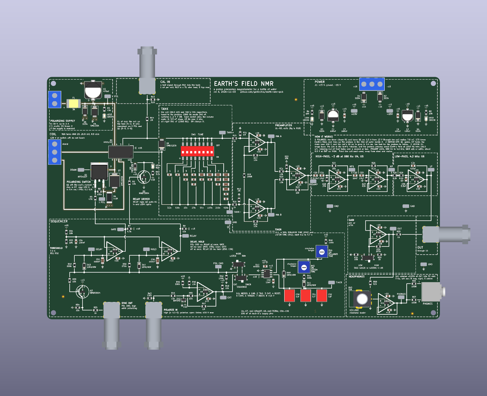

# Earth's Field NMR — a proton precession magnetometer on one board

Polarize the protons in a litre of water with a current through a coil, switch
the current off faster than they can follow, and listen: they precess about the
Earth's magnetic field at a couple of kilohertz and induce about a microvolt in the
same coil for a second or two.  This board does all of it — the polarizing switch,
the relay that hands the coil from the supply to the receiver, the tuned tank, a
low-noise preamplifier, the filters, the gain, and the sequencer that times it —
on a 243 x 150 mm, four layers printed circuit board whose silkscreen *is* the
schematic, with a headphone jack to hear the protons as well as see them.  Here in Claremont (Harvey Mudd, IGRF-14: 46.0 µT) the Larmor frequency
of the protons is 1960 Hz.



Every wire on the front is drawn on the silkscreen exactly where its copper runs;
every stage sits in a dashed box named for what it does; every node worth
looking at has a probe loop (26 of them, four of them ground).  The power rails
are planes, and each place a part meets one carries a ground symbol or a rail
flag, as a sheet carries a power symbol.

## What is on it

| block | what it does | parts |
|---|---|---|
| POLARIZING SUPPLY | 6-30 V, up to 3 A, from a battery or a bench supply | a resettable fuse, a reverse-polarity crowbar, a 33 V clamp, 470 µF, a lamp |
| COIL, K1 | at rest the coil is the tank's inductor; energized, the relay puts it across the supply and the switch | HFD3/12 DPDT relay, 3 A contacts |
| POLARIZING SWITCH | turns the coil's current on and, in 0.4 ms, off; the clamp takes the coil's energy at about 130 V | IRFS4227 (200 V) MOSFET, SMCJ100A clamp, 0.1 Ω sense resistor |
| TANK | tunes the coil to the protons: eight switches add binary-weighted C0G capacitance in 3.3 nF steps, to 841 nF | DSIC08 DIP switch, 20 C0G capacitors, a bidirectional clamp |
| CAL IN | a known test current into the tank, 1 µA per volt | BNC, 1 MΩ, 51 Ω |
| PREAMPLIFIER | three-op-amp instrumentation amplifier, x101 | OPA197 (U1-U3) |
| HIGH-PASS, LOW-PASS | 688 Hz to 4.2 kHz, fourth-order high-pass, second-order low-pass | OPA197 (U4-U6), Sallen-Key |
| GAIN, OUT | x21 or x201 more: x2121 (LOW) or x20301 (HIGH) from the tank to OUT | OPA197 (U7), a slide switch, BNC |
| HEADPHONES | the FID by ear: OUT through a VOLUME knob and a follower to both ears of a 3.5 mm stereo jack; about 30 mV, 81 dB SPL, in a 32 Ω earpiece at full volume on HIGH | ALPS RK09K 10k knob, OPA197 (U12), 100 Ω to each ear, Same Sky SJ1-3523N jack |
| SEQUENCER | polarize for 0.2-4.7 s, listen for 0.2-4.8 s; the relay closes first and opens last, so it never switches current | NE555, two TS391 comparators with RC delays, POLARIZE IN and SYNC OUT BNCs |
| POWER | ±15 V in, reverse-polarity diodes, clamps, lamps | |

## Using it

[docs/HANDBOOK.md](docs/HANDBOOK.md): what to wind for the coil, where to put it,
how to tune the tank for where you are, the bring-up in order with the expected
voltage at every probe loop, and the experiments (measuring the field, T2*, T1 by
the polarizing time).  The back of the board carries the short version.
**Caution:** the coil and Q1's drain swing to about 130 V for half a millisecond at
every switch-off.

## How it was designed

[docs/DESIGN_NOTES.md](docs/DESIGN_NOTES.md): why each block is what it is, the
arithmetic (`sim/design.py`, which writes `sim/design.json`: every value on the
sheet and the board comes from it), the simulation, the board, the risks for the
first board and the ideas for rev B.  [CLAUDE_CODE_CHAT.md](CLAUDE_CODE_CHAT.md)
is the conversation it came from.  `design_reviews/` holds the brief for
reviewers and the rounds run so far (the author's own, 2026-11-03).

## Ordering it

[docs/MANUFACTURING.md](docs/MANUFACTURING.md) is generated by the build: the files
to upload, JLCPCB's order form field by field, an estimate of the cost, and what to
look at in their placement preview.  The parts come to about $24 a board; every
part is stocked by JLCPCB.

## Building it

```bash
./make.py
```

runs, from `scripts/parts.py` and `sim/design.py` outward: the design arithmetic,
the symbols, footprints and 3D stand-ins, the schematic (`scripts/gen_sch.py`) and
its ERC, 393 circuit assertions on the exported netlist (`scripts/check_circuit.py`),
the ngspice simulation of that netlist (`sim/nmr_sim.py`: the tank, the receiver's
gain, band and noise, the switch-off, the sequencer and the headphones' level, each checked
against the arithmetic), the board (`scripts/layout.py`, laid out and wired by
`scripts/gen_pcb.py`, where every drawn wire is laid as copper) and its DRC with
schematic parity, the fab package and its checks (`scripts/check_outputs.py`), and
the generated documents, whose quoted numbers are checked against the build.
KiCad 10 and ngspice are needed; `./make.py --clean` removes what it generates.

## Files

- `hardware/` — the KiCad project (generated; do not edit by hand)
- `scripts/` — the generators and checkers
- `sim/` — the design arithmetic, the simulation and their results
- `out/earthnmr/` — gerbers, BOM, CPL, prints, assembly notes
- `docs/` — handbook, design notes, manufacturing, images
- `CLAUDE_CODE_CHAT.md` — how this was designed

## Licence

Hardware under CERN-OHL-P v2 (`LICENSE-HARDWARE.txt`), scripts under MIT
(`LICENSE`).  Jason Gallicchio and Claude, 2026.
